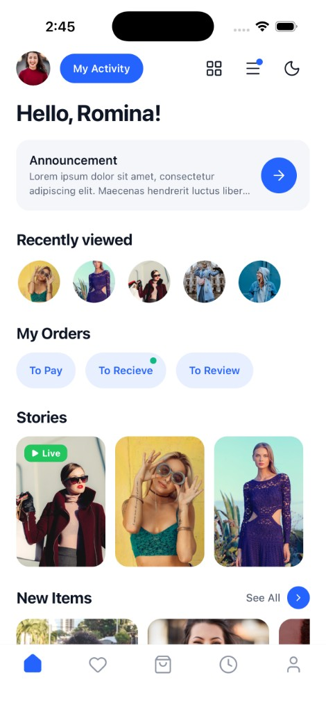
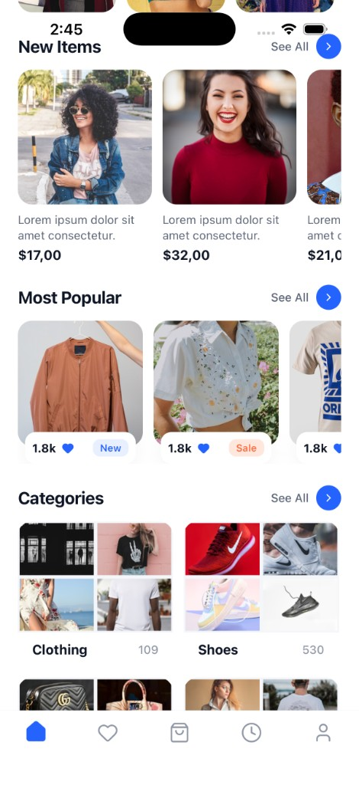

# Banbox

**Style delivered to your door** — a cross-platform fashion shopping app built with [Expo](https://expo.dev) and [React Native](https://reactnative.dev).

Banbox combines a personalized home feed, product discovery, and order tracking in a single mobile experience for iOS, Android, and web.

## Screenshots

<p align="center">
  
  
</p>

## Features

### Home

- Personalized greeting and profile header
- Announcement banner with call-to-action
- Recently viewed products (horizontal avatars)
- Order status shortcuts (To Pay, To Receive, To Review)
- Stories carousel with live badges
- New Items, Most Popular, and Categories sections
- Flash sale countdown and “Just for you” recommendations

### Navigation

Five bottom tabs:

| Tab      | Route              | Status      |
| -------- | ------------------ | ----------- |
| Home     | `/(tabs)/`         | Implemented |
| Wishlist | `/(tabs)/wishlist` | Coming soon |
| Cart     | `/(tabs)/cart`     | Coming soon |
| Orders   | `/(tabs)/orders`   | Coming soon |
| Profile  | `/(tabs)/profile`  | Coming soon |

### App experience

- Light and dark themes (system-aware)
- Animated splash screen on launch
- Route-level error boundaries with recovery UI
- Persisted state (auth, wishlist, recently viewed) via Zustand + AsyncStorage

## Tech stack

| Layer     | Choice                                                                 |
| --------- | ---------------------------------------------------------------------- |
| Framework | Expo SDK 54, React Native 0.81                                         |
| Routing   | [Expo Router](https://docs.expo.dev/router/introduction/) (file-based) |
| Language  | TypeScript (strict)                                                    |
| State     | [Zustand](https://github.com/pmndrs/zustand) with persistence          |
| Lists     | [@shopify/flash-list](https://shopify.github.io/flash-list/)           |
| Icons     | [Lucide](https://lucide.dev/) via `lucide-react-native`                |
| Images    | `expo-image`                                                           |
| API       | `fetch` wrapper in `libs/api.ts`                                       |

**Expo experiments enabled:** typed routes, React Compiler, New Architecture.

## Project structure

```
Banbox/
├── app/                    # Expo Router screens
│   ├── _layout.tsx         # Root layout, splash, error boundary
│   └── (tabs)/             # Bottom tab navigator
├── components/
│   ├── home/               # Home feed sections
│   ├── splash/             # Animated splash
│   ├── error/              # Error boundaries & fallback UI
│   └── ui/                 # Shared UI (Icon, Avatar, Badge, …)
├── constants/              # App name, API URL, tab config
├── hooks/                  # Splash, countdown, color scheme
├── libs/                   # API client (`apiRequest`)
├── services/               # `fetchHome`, auth, products
├── store/                  # Zustand store & slices
├── theme/                  # Colors, spacing, typography, ThemeProvider
├── types/                  # Shared TypeScript types
└── assets/images/          # Icons, splash, app icons
```

Path alias: `@/*` maps to the project root (see `tsconfig.json`).

## Quick start

```bash
npm install
npx expo start
```

For full environment setup (Xcode, Android Studio, native builds, API configuration), see **[setup.md](./setup.md)**.

## Scripts

| Command           | Description                              |
| ----------------- | ---------------------------------------- |
| `npm start`       | Start Expo dev server                    |
| `npm run ios`     | Build and run on iOS simulator/device    |
| `npm run android` | Build and run on Android emulator/device |
| `npm run web`     | Run in the browser                       |
| `npm run lint`    | Run ESLint (`eslint-config-expo`)        |

## Backend API

The app loads the home feed from `GET /home` on the server defined in `constants/index.ts` (`API_BASE_URL`). Auth endpoints are expected under `/home/login`, `/home/register`, and `/home/me`. See `services/` and `libs/api.ts` for request shapes.

If the API is unreachable during development, the home screen still renders; sections may be empty until data loads.

## Configuration

| Setting                       | Location                                        |
| ----------------------------- | ----------------------------------------------- |
| API base URL                  | `constants/index.ts` → `API_BASE_URL`           |
| App display name / bundle IDs | `app.json`                                      |
| Splash duration               | `constants/index.ts` → `SPLASH_MIN_DURATION_MS` |

## Learn more

- [Expo documentation](https://docs.expo.dev/)
- [Expo Router](https://docs.expo.dev/router/introduction/)
- [React Native](https://reactnative.dev/docs/getting-started)

## License

Private project — all rights reserved unless otherwise specified.
